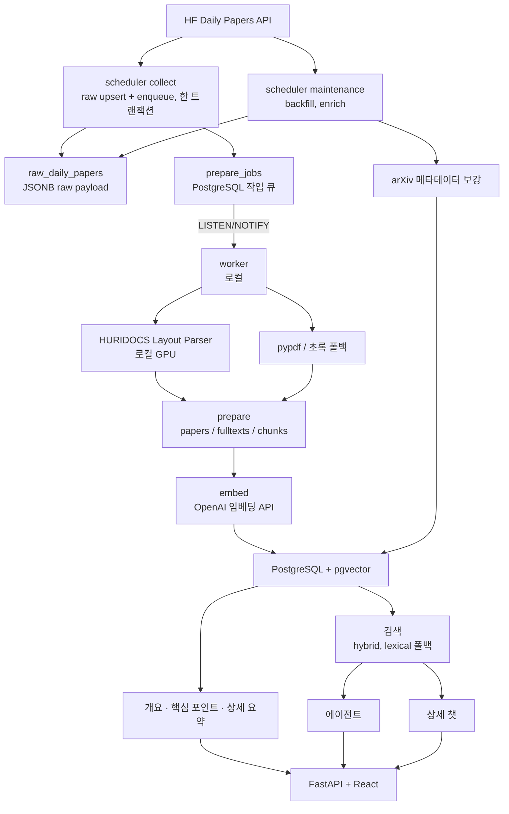
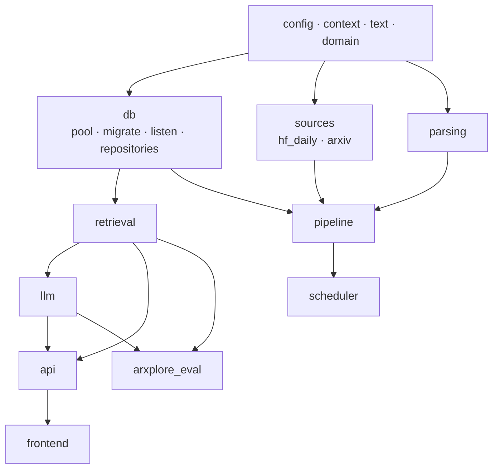

# ArXplore 시스템 아키텍처

## 1. 문서 목적

이 문서는 ArXplore의 런타임 구성과 모듈 경계를 코드 기준으로 설명한다. 실행 방법은 [SETUP.md](../SETUP.md), 평가는 [EVALUATION.md](../EVALUATION.md)에 있다.

ArXplore는 최신 AI 논문을 수집해 raw로 저장하고, prepare 큐로 넘긴 논문을 로컬 worker가 파싱·청킹·임베딩한 뒤, 검색과 LLM 생성을 거쳐 웹 UI로 보여 준다. 수집 자동화와 무거운 파싱은 같은 런타임에 있지 않다. 서버는 PostgreSQL과 스케줄러를 운영하고, 로컬 PC는 API·웹, GPU 파서, worker를 실행한다.

## 2. 시스템 전경

- 수집 자동화는 서버의 `arxplore scheduler`가 한다.
- prepare와 임베딩은 로컬 worker가 하고, 결과를 서버 DB에 직접 적재한다.
- GPU는 HURIDOCS 파서에만 쓴다. 임베딩은 OpenAI API(`text-embedding-3-large`, 1536차원)로 만든다.

서버가 큐를 만들고 로컬 worker가 소비하는 분리형 구조다. 서버에 GPU가 없어도 되고, 서버 DB를 공용 저장소로 유지할 수 있어 이 구조를 택했다.

## 3. 런타임 토폴로지

API, worker, 스케줄러는 같은 패키지(`src/arxplore`)와 같은 app 이미지를 쓰고 명령만 다르다. app 이미지는 `python:3.14-slim`에 `uv sync --frozen --no-dev`로 설치하고, UID 1000 비root 사용자로 `arxplore`를 진입점으로 돈다.

| 명령 | 역할 |
| --- | --- |
| `arxplore migrate` / `db-status` | 번호 SQL 마이그레이션 적용과 스키마 상태 확인 |
| `arxplore api` | FastAPI 앱(uvicorn) |
| `arxplore worker --loop` | prepare 큐 소비: 파싱, 청크 저장, 임베딩 |
| `arxplore scheduler` | collect, maintenance, langsmith_cleanup을 cron 일정으로 실행 |
| `arxplore run <작업>` | 작업 한 번 실행(수동 실행으로 기록), 코퍼스 도구 rechunk·reparse |
| `arxplore openapi` | API OpenAPI 스키마 내보내기 |

### 서버 런타임

`compose.server.yaml`(프로젝트 `arxplore_server`)의 서비스는 두 개다.

- `postgres`: pgvector/pgvector:pg16. 포트는 `TAILSCALE_SERVER_IP`에만 바인딩하고 데이터는 외부 볼륨에 둔다.
- `scheduler`: app 이미지의 `arxplore scheduler`. 같은 compose 네트워크의 `postgres:5432`로 접속한다.

### 로컬 서비스 런타임

`compose.yaml`(프로젝트 `arxplore`)의 기본 서비스는 `api`와 `web`이다.

- `api`: `arxplore api --host 0.0.0.0 --port 8001`. 워커 수는 `API_WORKERS`(기본 1)이고, `/bootstrap.json` HTTP healthcheck가 통과해야 healthy다.
- `web`: Node 24에서 빌드한 React 정적 파일을 nginx stable-alpine이 서빙하고 API 경로만 `api`로 프록시한다. `api`가 healthy일 때 뜬다.
- `dev` 프로필의 `vite`: HMR 개발 서버. API는 `http://api:8001`로 프록시한다.
- `local-db` 프로필의 `postgres-local`: 원격 서버 없이 쓰는 PostgreSQL(`127.0.0.1:${SERVER_POSTGRES_PORT:-15432}`). 같은 compose 네트워크에 있으므로 컨테이너는 `PROD_POSTGRES_HOST=postgres-local:5432`로 접속한다. 수집이 돌지 않으면 DB는 비어 있다.

마이그레이션은 서비스 시작에 넣지 않은 별도 단계다(`docker compose run --rm api migrate`). API와 worker는 시작할 때 스키마 버전과 임베딩 차원을 확인하고, 맞지 않으면 뜨지 않는다.

### 로컬 parser / worker 런타임

`parser` 프로필이 `layout-parser`(HURIDOCS v0.0.31, GPU)와 `worker`를 함께 올린다. worker는 파서 healthcheck가 통과한 뒤 뜬다. 코드에는 `LAYOUT_PARSER_BASE_URL` 기본값이 없고, compose가 worker에 값이 비어 있으면 `http://layout-parser:5060`을 넣는다. 값이 끝내 비어 있으면 layout 단계를 건너뛰고 pypdf로 내려간다.

## 4. 모듈 구조

### `src/arxplore`

- `config.py`: Pydantic `AppSettings`. 실행 위치의 `.env`(또는 `ARXPLORE_ENV_FILE`)를 읽고, 빈 값은 설정하지 않은 것으로 본다. 옛 이름(`DJANGO_*`, `OPENAI_API_BASE`)도 별칭으로 받는다. `host[:port]` 주소를 해석한다.
- `context.py`: 요청 범위 OpenAI 키·모델(`override_openai_runtime`)과 검색 관찰 훅(`observe_retrieval`)
- `text.py`: 서로게이트·제어 문자 제거, 공백 압축 같은 공용 문자열 함수
- `domain/`: papers, chunks, retrieval, jobs의 frozen dataclass
- `db/`: async 연결 풀(`pool`), 마이그레이션 실행기와 SQL 파일(`migrate`, `migrations/`), 상시 LISTEN 연결(`listen`), 테이블 묶음별 저장소 함수(`repositories/`: papers, fulltexts, embeddings, raw, pipeline_state, jobs, listing, ai_cache, generation_cache, scheduler_runs)
- `sources/`: HF Daily Papers JSON API 클라이언트(`hf_daily`), arXiv id 정규화·Atom 파싱·검색(`arxiv`), 메타데이터 배치 조회(`arxiv_metadata`)
- `parsing/`: HURIDOCS 클라이언트와 응답 검증(`layout_client`), 레이아웃 segment 해석(`layout`), pypdf 추출(`pdf_text`), 정제(`cleaner`), 섹션(`sections`), `content_role` 판정(`roles`), 청커(`chunker`), 3단계 폴백 조립(`fulltext`), 품질 지표(`quality`)
- `embedding.py`: 질의·청크 임베딩 async 클라이언트(64개 배치, 요청 범위 키 우선)
- `retrieval/`: 질의 정규화와 후보 수(`query`), lexical SQL·rerank·필터(`lexical`), 2단계 벡터 SQL과 rerank(`vector`), 점수 융합(`fusion`), 논문 다양성(`diversity`), 문맥 창(`windows`), 모드 선택(`service.Retriever`)
- `llm/`: 모델 팩토리(`models`), 추적(`tracing`), 프롬프트(`prompts/`), 개요·핵심 포인트(`detail`), 상세 요약 그래프(`summary_graph`), 상세 챗(`paper_chat`), 인용 대조(`citations`), 에이전트(`agent/`: graph, tools, stream)
- `pipeline/`: 수집(`collect`), 백필(`backfill`), 메타데이터 보강(`enrich`), prepare(`prepare/`: mapping, policy, paper, run), 임베딩(`embed`), worker 루프(`worker`), LangSmith 정리(`langsmith_cleanup`), 코퍼스 도구(`corpus`)
- `scheduler/`: cron 해석(`cron`), 작업 정의(`jobs`), 실행과 기록(`runner`), 조립(`service`)
- `api/`: 앱 팩토리와 예외 처리(`app`), CSRF·신뢰 Host·보안 헤더(`security`), rate limit(`ratelimit`), SSE(`sse`), 연결 끊김 감시(`disconnect`), 요청·응답 모델(`schemas`), 서비스(`services/`: listing, detail, generation, chat, store, arxiv_cache), 라우트(`routes/`: bootstrap, papers, generation, chat)
- `cli.py`: `arxplore` 명령. 각 패키지의 `commands.register`를 찾아 명령을 붙인다.

SQL은 ORM 없이 저장소 모듈의 상수와 빌더로 둔다. 저장소 함수는 풀이나 호출자 연결(`ConnectionSource`)을 받는다. 풀을 넘기면 호출 하나가 트랜잭션 하나이고, 연결을 넘기면 호출자의 트랜잭션 안에서 돈다. 수집이 raw 저장과 잡 등록을 한 트랜잭션으로 묶는 방식이 이것이다.

### `src/arxplore_eval`

검색·생성 평가 하네스와 `arxplore-eval` 명령이다. 제품의 공개 함수만 조립하고, 옛 가중 RRF 같은 연구용 융합은 `research_fusion`에 둔다. 데이터(질의셋, 케이스, 결과, 캐시)는 `eval/`에 있다. 사용법은 [eval/README.md](../../eval/README.md)에 있다.

### `frontend`

React 19, React Router 7 데이터 라우터, TanStack Query, CSS Modules, TypeScript다.

- `src/app/`: 라우터(`routes.tsx`, 페이지 lazy 로딩), bootstrap 게이트, provider, 오류 경계
- `src/pages/`: 목록, 상세, 어시스턴트, 404 화면을 조립만 한다.
- `src/features/`: `papers-list`(URL 쿼리가 원본인 목록 상태), `paper-detail`(개요·요약 카드, 요약 모델 대화상자, PDF 분할창), `chat`(두 채팅이 함께 쓰는 `useChatStream`, 인용 목록, 마크다운), `paper-chat`, `assistant`
- `src/shared/`: `api`(HTTP, SSE, OpenAPI 생성 타입), `ui`(Modal, Spinner, 아이콘), `lib`(safeUrl, 키보드, arXiv 링크), `styles`(토큰, reset)

목록과 상세는 Query 쿼리이고, 개요와 요약은 취소할 수 있는 mutation이다. API 타입은 `frontend/openapi.json`(`arxplore openapi` 출력)에서 `npm run generate:api`로 만든다. UI는 API만 소비하고 저장 구조나 외부 연동을 직접 구현하지 않는다.

## 5. 데이터 흐름

1. 스케줄러의 collect가 매일 18:00(`SCHEDULER_TIMEZONE`, 기본 Asia/Seoul)에 그날의 HF Daily Papers를 `/api/daily_papers?date=` JSON으로 받는다. 수집 날짜도 같은 시간대로 계산한다.
2. HTTP 수집을 끝낸 뒤 연결 하나로 raw payload를 `raw_daily_papers`에 upsert하고 날짜를 `prepare_jobs`에 등록해 한 번에 커밋한다. `pg_notify`는 커밋 때 전달되므로 worker가 깨어났을 때 raw는 항상 보인다.
3. worker는 LISTEN 전용 연결을 계속 열어 두고 알림을 기다리다가 잡을 claim한다.
4. prepare가 raw payload에서 논문 후보(arXiv id, 메타데이터, PDF 주소)를 만든다.
5. 저장된 본문이 확정 상태(source `layout_pdf`, 청크와 `content_hash` 있음)이고 force가 아니면 다운로드와 파싱 없이 papers 행의 HF 신호만 갱신한다. 그 밖에는 PDF를 받아 HURIDOCS, 실패하면 pypdf, 그것도 실패하면 초록으로 파싱한다.
6. 섹션, 품질 지표, parser metadata를 만들고 섹션 단위로 청킹한다(최대 1,800자, 이웃 청크 200자 겹침).
7. 파싱이 끝난 뒤 `papers`, `paper_fulltexts`, `paper_chunks`를 저장한다. 보강된 메타데이터는 HF 값으로 덮지 않는다.
8. 임베딩이 없는 청크를 임베딩한다. `references` 역할 청크는 임베딩하지 않는다.
9. 스케줄러의 maintenance가 3시간마다 과거 날짜를 백필 수집(backfill 잡 등록 포함)하고 arXiv 메타데이터를 보강한다. 백필이 실패해도 보강은 돈다.
10. 검색, 상세 문서 생성, 에이전트가 이 데이터를 소비한다.

`raw_daily_papers`의 raw payload가 원본이고, 정제층(`papers`, `paper_fulltexts`, `paper_chunks`, `paper_embeddings`)은 raw에서 다시 만들 수 있는 읽기·검색 계층이다. 둘 다 같은 PostgreSQL에 있다.

## 6. 저장 구조

### 마이그레이션

스키마는 `src/arxplore/db/migrations`의 번호 SQL만 바꾸고, `arxplore migrate`만 DDL을 실행한다.

| 파일 | 내용 |
| --- | --- |
| `0001_baseline.sql` | 리팩토링 전 스키마 전체. 이미 그 스키마가 있는 DB에서는 아무것도 바꾸지 않고 버전만 기록한다 |
| `0002_drop_legacy_topics.sql` | 쓰지 않던 `topics`, `topic_papers`, `topic_documents` 삭제 |
| `0003_prepare_jobs_date_and_status.sql` | `prepare_jobs.target_date`를 DATE로 바꾸고 status CHECK 추가. ISO 날짜가 아닌 값이 있으면 파일 전체를 되돌린다 |
| `0004_ai_cache_prompt_version.sql` | AI 캐시 두 테이블에 `prompt_version`(기본 1) 추가 |
| `0005_scheduler_runs.sql` | 스케줄러 실행 기록 테이블 |
| `0006_papers_arxiv_lookup_backoff.sql` | arXiv에 없는 논문의 재조회 간격을 위한 `papers.arxiv_lookup_*` |

- 실행기는 `schema_migrations(version, checksum, applied_at)`에 파일마다 기록하고, 세션 advisory lock으로 동시 실행을 막고, 파일 하나를 트랜잭션 하나로 돌린다.
- 적용한 파일이 바뀌었거나, 이 빌드가 모르는 버전이 DB에 있거나, 이미 적용한 버전보다 낮은 대기 파일이 있으면 아무것도 적용하기 전에 멈춘다. 적용한 파일은 고치지 않고 새 번호를 더한다.
- API와 worker, 스케줄러는 시작할 때 `verify_schema`로 대기 마이그레이션, 바뀐 파일, 모르는 버전, `paper_embeddings.embedding` 차원과 `OPENAI_EMBEDDING_DIMENSIONS`를 확인한다.
- HNSW 생성이 실패하면 경고만 남기고, `arxplore db-status`가 인덱스를 MISSING으로 보여 준다.

### 테이블

PostgreSQL이 유일한 저장소다. 애플리케이션 DB(`APP_POSTGRES_DB`) 하나에 raw payload, 파이프라인 상태, 정제 데이터, 벡터, 큐, AI 캐시, 스케줄러 기록이 있다.

| 테이블 | 키 | 주요 컬럼 | 인덱스·제약 |
| --- | --- | --- | --- |
| `raw_daily_papers` | `(source, date)` PK | `payload` JSONB(HF 응답 원본), `payload_hash`(키 순서와 무관한 sha256), `revision`(hash가 바뀔 때만 +1), `fetched_count`, `collected_at` | PK만 |
| `pipeline_state` | `key` PK(`<pipeline>:<name>`) | `value` JSONB(backfill 커서, 마지막 처리 날짜, 마지막 실패), `updated_at` | PK만 |
| `papers` | `arxiv_id` PK | `title`, `authors` JSONB, `abstract`, `categories` JSONB, `pdf_url`, `published_at`, `upvotes`, `github_url`, `source`, `arxiv_lookup_*`, `title_abstract_vector` tsvector 생성 컬럼(제목 A + 초록 B, `english`) | GIN(`title_abstract_vector`) |
| `paper_fulltexts` | `arxiv_id` PK, FK → `papers` | `text`, `sections` JSONB, `source`(`layout_pdf` / `pdf` / `fallback_abstract`), `quality_metrics`, `artifacts`, `parser_metadata` JSONB, `content_hash` | PK만 |
| `paper_chunks` | `id` BIGSERIAL PK, FK `arxiv_id` → `papers` | `chunk_index`, `chunk_text`, `section_title`, `token_count`, `metadata` JSONB(`content_role` 포함), `chunk_vector` tsvector 생성 컬럼 | `UNIQUE(arxiv_id, chunk_index)`, GIN(`chunk_vector`) |
| `paper_embeddings` | `chunk_id` PK, FK → `paper_chunks` | `embedding VECTOR(1536)`, `model_name` | HNSW(`embedding vector_cosine_ops`) |
| `paper_ai_overviews` | `arxiv_id` PK | `overview`, `key_findings` JSONB, `model`, `prompt_version` | PK만 |
| `paper_ai_detailed_summaries` | `id` PK | `arxiv_id`, `model`, `summary`, `prompt_version` | `UNIQUE(arxiv_id, model)` |
| `prepare_jobs` | `id` BIGSERIAL PK | `mode`, `target_date` DATE, `status`, `attempt_count`, `worker_id`, `claim_generation`, `claimed_at`, `heartbeat_at`, `next_attempt_at`, `raw_revision`, `pending_refresh`, `payload`/`result` JSONB, `error` | `UNIQUE(mode, target_date)`, status CHECK, `(mode, status, target_date)`, `(status, updated_at DESC)` |
| `scheduler_runs` | `id` BIGSERIAL PK | `job`, `trigger`(scheduled / manual), `scheduled_for`, `status`(running / success / failed / abandoned), `params`, `result`, `error`, `attempts`, `started_at`, `finished_at` | 예약 실행의 `(job, scheduled_for)` 유일 인덱스, `(job, started_at DESC)` |
| `schema_migrations` | `version` PK | `checksum`, `applied_at` | PK만 |

raw 저장 규칙
- 저장은 `INSERT ... ON CONFLICT (source, date) DO UPDATE` 한 문장이다. revision은 이전 hash와 새 hash를 비교해 같은 문장 안에서 정하므로 동시 저장에도 빠지거나 겹치지 않는다. 같은 hash면 payload는 그대로 두고 `collected_at`만 갱신한다.
- JSONB가 받지 않는 NUL 문자와 짝 없는 서로게이트는 hash 계산 전에 지운다.

연결
- 연결 풀은 psycopg 3 `AsyncConnectionPool`이다. 프로세스(API 워커, worker, 스케줄러)마다 최대 `POSTGRES_POOL_MAX`(기본 8)개이고, 고갈되면 `POSTGRES_POOL_TIMEOUT`(기본 30초)까지 기다린다. 연결마다 `connect_timeout`과 `application_name=arxplore-<역할>`을 붙인다.
- worker의 LISTEN은 풀 밖의 전용 연결 하나를 실행 사이에 계속 쓴다. 끊기면 다시 구독하고 바로 큐를 확인한다.

## 7. prepare 큐 동작

`prepare_jobs`는 사용자에게 보이지 않지만 서버 스케줄러와 로컬 worker를 잇는 경계다.

- **enqueue**: `(mode, target_date)` 기준 upsert 뒤 `pg_notify('arxplore_prepare_jobs')`. `failed` 잡은 새 입력으로 보고 시도 횟수를 초기화해 `pending`으로 되돌린다. raw revision이 올라가면 `done` 잡도 `pending`으로 되돌리고, 처리 중이면 `pending_refresh`로 표시한다.
- **mode**: 최신 수집은 `auto`, 백필 수집은 `backfill`이다. worker는 `auto`를 먼저 가져가고, `PREPARE_BACKFILL_ENABLED=true`일 때만 `backfill`도 가져간다.
- **claim**: `FOR UPDATE SKIP LOCKED`로 `pending`이면서 재시도 대기(`next_attempt_at`)가 지난 잡 한 건을 `processing`으로 바꾸고, `attempt_count`와 `claim_generation`을 올려 `(job_id, worker_id, claim_generation)` 토큰을 돌려준다.
- **heartbeat**: 논문을 시작할 때와 처리하는 동안 `min(60초, stale 임계 / 3)`마다 토큰을 확인하며 `heartbeat_at`을 갱신한다. claim을 잃었으면 처리를 멈춘다.
- **stale 판정**: 따로 도는 감시 프로세스는 없다. worker가 claim할 때 `COALESCE(heartbeat_at, claimed_at)`이 `PREPARE_JOB_STALE_SECONDS`(기본 900초)보다 오래된 `processing` 잡을 되돌린다. 시도 횟수가 남았으면 `pending`, 소진했으면 `failed`다.
- **complete**: 토큰이 맞을 때만 `done`으로 바꾼다. 처리 중 새 raw revision이 들어왔으면 `pending`으로 한 번 더 돌린다.
- **fail**: 토큰이 맞을 때만 반영한다. `attempt_count < PREPARE_JOB_MAX_ATTEMPTS`(기본 3)이면 `60초 × 2^(n-1)`(최대 1시간) 뒤 재시도하도록 `pending`, 소진했으면 `failed`다.
- **다시 열기**: `arxplore run reparse --since ... --until ... [--no-force] --apply`가 수집된 날짜의 잡을 다시 연다(기본 dry-run, 처리 중인 잡은 건드리지 않음).

prepare 단계의 보호 장치
- 논문 단위 격리: 한 논문의 예외는 결과에 기록하고 나머지를 계속 처리한다. 실패한 논문이 하나라도 있으면 잡은 backoff 뒤 재시도되고, 저장이 끝난 논문은 재시도에서 건너뛴다.
- 멱등 재처리: source 순위 `layout_pdf > pdf > fallback_abstract`에서 하향 저장을 막고, 같은 source와 같은 `content_hash`면 저장을 건너뛴다. 청크 텍스트가 같으면 id와 임베딩을 지킨 채 메타데이터만 갱신한다. 강제 재처리는 `worker --force`, 잡 payload `force: true`, `run reparse`다.
- 파싱 전 판단: 확정된 layout 본문이 있는 논문은 다운로드와 파싱을 건너뛰고 `parse_skipped`로 보고한다. pdf·초록 폴백 본문은 나중의 layout 결과로 바뀔 수 있게 매번 다시 파싱한다.
- 임베딩: 논문마다 라운드당 200청크, 최대 100라운드를 임베딩하고, 실행이 끝날 때마다 다른 논문의 backlog를 400청크까지 채운다. backlog 오류는 worker를 멈추지 않는다.

## 8. 스케줄러

`arxplore scheduler`는 서버에서 한 프로세스로 돌며 `SCHEDULER_TIMEZONE`으로 cron을 해석한다.

| 작업 | cron | 내용 |
| --- | --- | --- |
| `collect` | `0 18 * * *` | 그날의 HF Daily Papers 수집과 enqueue. 실패하면 10분 간격으로 3번 더 시도한다 |
| `maintenance` | `0 */3 * * *` | 과거 날짜 백필 뒤 arXiv 메타데이터 보강. 백필이 실패해도 보강은 돌고 실행은 실패로 남는다 |
| `langsmith_cleanup` | `0 3 * * *` | 14일이 지난 LangSmith trace 정리. `LANGSMITH_API_KEY`가 없으면 건너뛴다 |

- 실행 기록은 `scheduler_runs`에 남는다. 예약 실행은 `(job, scheduled_for)` 유일 인덱스로 한 슬롯을 두 번 돌리지 않는다.
- 시작할 때 직전 슬롯의 기록이 없으면 그 슬롯을 한 번 돌린다. 여러 슬롯을 놓쳤어도 한 번이다. 멈춘 스케줄러가 남긴 `running` 행은 `abandoned`로 바꾼다.
- 세션 advisory lock으로 인스턴스 하나만 돈다.
- 수동 실행은 `arxplore run collect|maintenance|langsmith-cleanup`이고 `trigger=manual`로 기록된다. 최근 기록은 `arxplore scheduler history`로 본다.
- arXiv가 돌려주지 않은 논문은 1·2·4·8·16·30일 간격으로만 다시 조회한다. rate limit이나 타임아웃으로 실패한 조회는 기록하지 않는다.

## 9. 검색 계층

제품 경로는 `retrieval.service.Retriever.retrieve_contexts`가 고른다. 에이전트 검색 도구와 상세 챗이 같은 함수를 쓴다.

| 경로 | 제품 사용 | 구현 |
| --- | --- | --- |
| hybrid | 기본(`RETRIEVAL_MODE=hybrid`이고 질의 임베딩 키가 있을 때) | 두 채널을 각자 풀 연결로 동시에 돌리고, 채널 점수를 질의마다 min-max 정규화해 0.35 × lexical + 0.65 × vector로 합친다. 한 채널에만 나온 후보의 다른 채널 점수는 0이다. vector 결과가 있으면 lexical의 부분 일치 행은 빼고 합친다 |
| lexical | 폴백(키 없음, 임베딩 호출 `OpenAIError`, `RETRIEVAL_MODE=lexical`) | 제목·초록·청크 tsvector에 `websearch_to_tsquery`/`plainto_tsquery`로 `ts_rank_cd`(strict 일치) 또는 OR 질의 × lexeme coverage(부분 일치), ILIKE 보너스, 섹션·`content_role` 가중, 질의 토큰 겹침 rerank, 참고문헌형 텍스트 필터 |
| vector | hybrid 구성 요소 | `paper_embeddings` 코사인 거리 1단계 후보를 뽑고 섹션·`content_role` 감점과 `VECTOR_MIN_SIMILARITY` 하한으로 다시 정렬 |

- hybrid에서 lexical 예외가 나면 그대로 올라가고 vector 채널을 취소한다. 질의 임베딩의 `OpenAIError`만 폴백용 후보 수로 lexical을 새로 돌리는 폴백으로 이어진다.
- 전체(논문 범위가 아닌) 검색은 SQL 안에서 논문마다 점수 상위 3청크만 남기고, 마지막에 논문 다양성 규칙이 논문당 2청크를 우선한다. 결과는 앞뒤 한 청크씩의 문맥 창으로 넓힌다.
- 벡터 검색은 2단계다. 1단계는 `ORDER BY embedding <=> 질의 LIMIT max(limit × 8, 80)`이고, 후보가 40개를 넘으면 트랜잭션 범위로 `hnsw.ef_search`를 후보 수(최대 1000)까지 올린다. 이 설정문과 규칙은 `retrieval.vector.hnsw_ef_search_statement`다. 논문 범위 검색은 그 논문의 청크만 모아 정확 정렬한다.
- 지금 코퍼스 규모(임베딩 13,328개)에서는 제품 경로의 벡터 1단계가 플래너 판단으로 HNSW 대신 순차 스캔을 탄다. 단독 검색은 후보 240개, hybrid는 600개이고, HNSW는 후보 184개까지만 쓰인다. 실행 계획은 `arxplore-eval explain`으로 확인한다.
- 검색 SQL과 설정문은 `prepare=False`로 보내 호출마다 실제 값으로 계획을 세운다. 벡터는 `%.12f` 텍스트 리터럴로 보낸다.
- `references` 판정은 섹션 제목이 참고문헌 제목과 일치할 때만 참이다. 규칙과 정규식은 `parsing.roles` 한 곳에 있고 청커, lexical SQL, Python 필터, vector rerank가 같이 쓴다.
- FTS 설정이 `english`라 한국어 질의는 lexical에서 거의 맞지 않는다. 키가 없어 lexical로 내려가면 한국어 검색 품질이 크게 떨어진다.
- 상세 챗은 같은 경로를 `arxiv_id`로 한정해 부르고, 결과가 비면 논문의 앞 청크로 대신한다(`retrieval_mode: "first_chunks"`).

## 10. LLM 계층

- **모델**: 모델 팩토리는 `llm.models` 하나다. 키는 요청 범위 키, 서버 `OPENAI_API_KEY` 순, 모델은 인자, 요청 범위, `OPENAI_MODEL`(기본 gpt-4o) 순으로 고른다. gpt-5 계열에는 temperature를 넘기지 않는다.
- **개요·핵심 포인트**: `llm.detail`. 모델은 gpt-5-mini이고, 섹션 8개를 골라 개요와 핵심 포인트를 만든다. 핵심 포인트 앞의 번호 표식은 뒤에 숫자가 오지 않을 때만 지워 `3.5%` 같은 소수를 지킨다.
- **상세 요약**: `llm.summary_graph`. 섹션을 배경·방법·실험·한계 네 버킷과 other로 나눠 요약한 뒤 병합한다. 네 버킷은 병렬로 돌고, other는 front_matter·references·toc와 감사의 글을 뺀 본문 섹션만 요약해 병합 입력 끝에 붙인다. 모델은 요청마다 gpt-5-mini 또는 gpt-5다.
- **캐시**: 개요는 `arxiv_id`, 상세 요약은 `(arxiv_id, model)`로 캐시한다. `prompt_version`이 현재 버전(개요 `ANALYSIS_PROMPT_VERSION`, 요약 `SUMMARY_PROMPT_VERSION`, 지금 둘 다 2)과 다른 행은 캐시로 보지 않고 새로 만든 뒤 같은 행을 덮어쓴다.
- **상세 챗**: `llm.paper_chat`. 초록(1번 출처)과 질문으로 논문 안을 검색한 청크 최대 5개를 넣고, 답변의 `[n]` 번호를 발췌문과 대조해 인용을 만든다.
- **에이전트**: `llm.agent`. `langchain.agents.create_agent`에 도구 두 개와 미들웨어 두 개를 붙인다.
  - `search_paper_chunks_tool`: 제품 검색으로 문맥 5개를 찾아 `[번호] 제목 | arxiv_id | 섹션 | chunk_id` 헤더, 출처 URL, 본문으로 넘기고 hit을 요청 범위 레지스트리에 기록한다.
  - `get_trending_papers_tool`: 최근 논문 10편을 추천수 순으로 돌려준다.
  - `RequestModelMiddleware`가 호출마다 요청 범위 모델과 키를 고르고, `StepLimitMiddleware`가 남은 단계가 부족할 때의 도구 호출을 단계 제한 안내로 바꾼다. `recursion_limit=AGENT_RECURSION_LIMIT`(기본 12)을 넘으면 `GraphRecursionError`를 같은 안내 문구로 끝낸다.
  - 스트림은 노드 `model`의 조각을 `AGENT_STREAM_BUFFER_CHARS`(기본 120자)까지 보류해, 도구 호출 앞의 짧은 서두가 답변에 섞이지 않게 한다. 120자를 넘는 서두 뒤의 도구 호출은 막지 못한다.
  - 대화 이력은 user/assistant만 최근 20개, 메시지당 4,000자로 자른다. 도구 결과는 지시가 아니라 데이터로 다루라는 규칙이 프롬프트에 있다.
- **인용**: 에이전트는 답변 속 마크다운 링크를, 상세 챗은 `[n]` 번호를 도구 hit·발췌문과 대조해 `citations` 이벤트(`in_answer`)를 한 번 보낸다. 도구 결과에 없는 링크는 서버 로그에 경고로 남긴다.
- **추적**: 환경변수를 바꾸지 않고 langsmith `tracing_context`를 명시적으로 넘긴다. stage는 `paper_overview`, `paper_key_findings`, `summary`, `paper_chat`, `agent_chat`이고, 태그는 `stage:`, `runtime:`(`RUNTIME` 설정), `project:`, `user:`다.

## 11. API

FastAPI 앱(`api.app.create_app`)의 경로는 다음과 같다. 요청·응답 모델과 SSE 이벤트는 `arxplore openapi` 스키마에 있다.

| 메서드와 경로 | 내용 | rate limit |
| --- | --- | --- |
| `GET /bootstrap.json` | CSRF 쿠키를 심고 요약 모델 기본값·목록을 돌려준다 | - |
| `GET /papers/` | `/?원래 쿼리`로 302 | - |
| `GET /papers/list.json` | 목록과 검색. 쪽당 21편, `sort=latest|upvotes`, `q` | - |
| `GET /papers/<id>/detail.json` | 논문과 관련 논문(로컬 + arXiv 외부 검색) | detail |
| `POST /papers/<id>/analyze/` | 개요·핵심 포인트. 캐시가 있으면 `cached: true` | llm |
| `POST /papers/<id>/summary/` | 상세 요약. 본문 `{"model": ...}` | llm |
| `POST /papers/<id>/chat/`, `/chat/stream/` | 상세 챗(JSON, SSE) | llm |
| `POST /papers/assistant/chat/`, `/stream/` | 에이전트(JSON, SSE) | llm |

- **오류**: 모든 오류가 `{"error": 문구}`다. 요청 검증 실패는 400 "잘못된 요청입니다.", 405는 빈 본문과 `Allow`, 모르는 경로는 JSON 404, 서버 `OPENAI_API_KEY`가 없으면 생성·챗은 503이다.
- **CSRF**: `/bootstrap.json`이 `csrftoken` 쿠키(1년, `Path=/`, `SameSite=Lax`, JS가 읽으므로 HttpOnly 아님, `SECURE_COOKIES`면 Secure)를 심는다. 변경 요청은 `X-CSRFToken` 헤더가 쿠키와 같아야 하고, Origin 헤더가 있으면 같은 출처이거나 `CSRF_TRUSTED_ORIGINS`에 있어야 한다. 실패는 403 JSON이다.
- **rate limit**: 벽시계 분 단위 고정 창, 키 `ratelimit:{scope}:ip:{ip}:{창 시작}`, TTL 65초. LLM을 부르는 6개 경로가 llm 버킷(`RATE_LIMIT_LLM_PER_MINUTE`)을 공유하고 `detail.json`은 detail 버킷(`RATE_LIMIT_DETAIL_PER_MINUTE`)이다. 메서드·CSRF 검사 뒤에 센다. 클라이언트 IP는 `RATE_LIMIT_IP_HEADER`의 첫 값, 소켓 주소, `unknown` 순이다. 저장소는 프로세스 메모리이고 `REDIS_URL`이 있으면 Redis다. 초과하면 429 `{"error", "retry_after"}`와 `Retry-After`다.
- **SSE**: `text/event-stream`, `Cache-Control: no-cache`, `X-Accel-Buffering: no`. 프레임은 `data: {json}`이고 순서는 `chunk`* → `citations` 1회 → `[DONE]`, 오류면 `error` → `[DONE]`이다. 입력 검증(400·404·503)은 스트림 전에 끝난다.
- **연결 끊김**: SSE는 응답 중에 `http.disconnect`를 따로 기다려 끊기면 에이전트 그래프와 OpenAI 스트림을 취소한다. 스트림이 아닌 LLM 경로도 끊기면 생성을 취소하고 캐시하지 않는다.
- **보안 헤더**: `X-Content-Type-Options`, `X-Frame-Options: DENY`, `Referrer-Policy`, `Cross-Origin-Opener-Policy`를 붙이고, `ALLOWED_HOSTS` 밖 Host는 400이다.
- **관련 논문**: 로컬 최근 300편의 키워드 점수와 arXiv 외부 검색을 합친다. 외부 검색은 (질의, 개수)별로 1시간, 최대 512개까지 성공 결과를 캐시한다.
- **SPA 서빙**: 운영은 nginx가 한다. `SERVE_FRONTEND_DIST=true`면 API가 실행 위치의 `frontend/dist`를 `/`에서 SPA로 서빙하고, 없는 `/assets/*`는 404다.

## 12. 기술적 결정과 트레이드오프

- **PostgreSQL 단일 저장소**: raw payload, 파이프라인 상태, 정제 데이터, 벡터, 작업 큐, AI 결과 캐시, 스케줄러 기록을 한 DB에 둔다. raw 저장과 작업 등록을 한 트랜잭션으로 묶고, 별도 메시지 브로커 없이 `SKIP LOCKED`와 `LISTEN/NOTIFY`로 큐를 만들 수 있다. 대신 벡터 인덱스와 FTS 튜닝을 직접 챙겨야 하고, 규모가 커지면 분리를 검토해야 한다.
- **서버/로컬 worker 분리**: 서버는 항상 켜진 수집·저장만 맡고, GPU가 필요한 파싱은 로컬 worker가 서버 DB에 직접 적재한다. 서버에 GPU가 없어도 되지만, 로컬 worker가 꺼져 있으면 수집분이 처리되지 않고 Tailscale 연결에 기댄다.
- **경량 스케줄러**: 작업 세 개를 cron과 실행 기록 테이블로 돌린다. 서버 컨테이너가 postgres와 scheduler 둘로 줄었지만, 태스크 UI와 로그 화면은 없고 `scheduler history`와 `run`으로 대신한다.
- **번호 마이그레이션**: DDL을 요청 경로와 worker에서 빼고 `migrate` 한 곳에 모았다. 배포 절차가 한 단계 늘지만 스키마보다 오래된 코드나 차원이 다른 설정으로 뜨는 것을 막는다.
- **async 전 구간**: API, DB, OpenAI, LangGraph를 async로 쓰고, 파싱·청킹 같은 CPU 작업은 동기 함수로 두고 스레드에서 부른다. SSE 스트림이 스레드를 점유하지 않는다.
- **3단 파서 폴백**: HURIDOCS 레이아웃 분석이 섹션 구조를 가장 잘 살리지만 GPU 컨테이너와 긴 처리 시간이 필요하다. 실패하면 pypdf, 그것도 실패하면 초록으로 내려가 최소한의 청크는 남긴다. 폴백 결과가 기존 PDF 본문을 덮지 않는다.
- **AI 결과 캐시**: 모든 방문자가 캐시를 공유하므로 같은 논문을 다시 열 때 LLM을 부르지 않는다. 프롬프트나 후처리를 바꾸면 프롬프트 버전을 올려 이전 결과를 첫 요청 때 다시 만든다. 한 방문자가 만든 결과를 모두가 본다.
- **골든 기반 동등성**: 리팩토링 전 구현의 출력(검색 순위, 청크, 파서, LLM 요청, HTTP·SSE, 화면)을 골든으로 고정하고, 동작을 바꾸는 수정은 골든 변형과 차이 기록을 남긴다. 절차는 [AGENTS.md](./AGENTS.md)에 있다.
